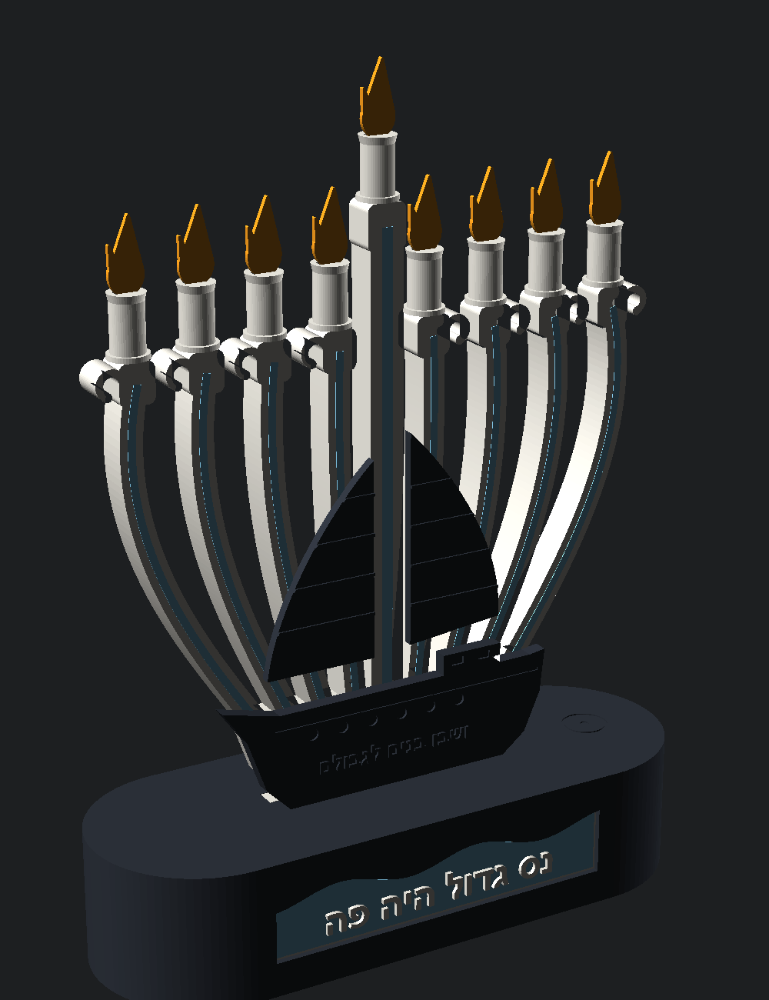

# 🕎 גלי העלייה – חנוכייה מוארת

**תכננה ובנתה: נועה יהוד**

חנוכיית LED לתערוכת חנוכיות, בהשראת העלייה לארץ ישראל.
שמונה גלים זוהרים יוצאים כמו מניפה מספינת מפרש. כל גל נשבר בקצף ועליו נר,
והתורן של הספינה הוא השמש. על הספינה כתוב "ושבו בנים לגבולם", ועל החלון המואר בבסיס "נס גדול היה פה".

**דף הפרויקט ולוח הבקרה:** https://amir684.github.io/Hanukkiah-Galei-HaAliyah/

## מה יש כאן
| תיקייה | מה יש בה |
|---|---|
| [`model/`](model/) | מודל OpenSCAD פרמטרי, קובצי STL ופלטות מוכנות ל-Bambu Lab |
| [`electronics/`](electronics/) | שרטוט חיווט ורשימת רכיבים |
| [`firmware/`](firmware/) | קוד ל-ESP32-S3: לוח שנה עברי, טקס הדלקה, שליטה בבלוטות' וב-WiFi |
| [`docs/`](docs/) | דף הפרויקט (GitHub Pages) עם לוח הבקרה בבלוטות' |
| [`sticker/`](sticker/) | מדבקה עם ברקוד QR שמוביל ללוח הבקרה |

## מידות ונתונים
- 234 מ"מ רוחב, כ-335 מ"מ גובה עד להבת השמש
- 8 נרות ושמש עם נורות להבה מרצדות
- 236 לדים: 180 בגלים, 34 בתורן, 22 בחלון הבסיס

## שליטה
- **בלוטות'** (Chrome באנדרואיד או במחשב): בדף הפרויקט, "לוח בקרה" → "התחבר בבלוטות'" → קוד PIN.
- **WiFi** (גם באייפון): מתחברים לרשת **Hanukkiah** ונכנסים ל-http://192.168.4.1.
  אם החנוכייה מחוברת לרשת הביתית: http://hanukkiah.local

---
© נועה יהוד. כל הזכויות שמורות.
